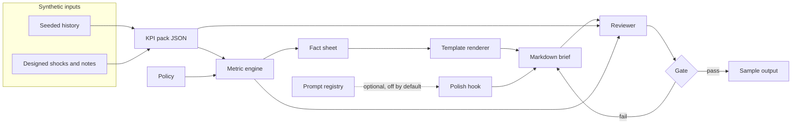

# Architecture

Ops Narrative turns a structured KPI pack into an executive brief and then checks the brief against that same pack. The narrator and the reviewer share one metric engine. They do not share a private list of "numbers I meant to use."

The sample company, Calderwisp Wholesale, is fictional. Nodes, categories, notes, and figures are generated in this repository. Nothing here is a client extract.

## Boundaries

| Module | Owns | Does not own |
| --- | --- | --- |
| `ops_narrative.models` | The pack: additive inputs at node × category, plus operating notes | Rates, rollups, prose |
| `ops_narrative.data` | Deterministic history, shocks, JSON read/write, validation | Commentary |
| `ops_narrative.policy` | Materiality bars, exception standards, concentration and drill rules | Sentence wording |
| `ops_narrative.formatutil` | Half-up display formats | Which fact is cited |
| `ops_narrative.metrics.engine` | Rollups, derived rates, the fact sheet, exception and materiality lists | Markdown |
| `ops_narrative.narrative` | Versioned templates, prompts, and the deterministic renderer | Deciding that a figure is true |
| `ops_narrative.review` | Faithfulness, direction, attribution, and template coverage | New analysis |
| `ops_narrative.charts` | Three descriptive figures | Causal claims |
| `ops_narrative.cli` / `app` | How a person runs the pipeline | Business rules |

Pandas is intentionally absent. A pack is twelve leaves. A typed rollup is easier to test than a frame, and the test is the product.

## Data flow

The polish hook is not on this path unless `OPS_NARRATIVE_LLM=1` and a caller injects a transport. The CLI does not inject one. If a transport returns text that fails the gate, the deterministic draft is what gets kept.

## Pack contract

A pack stores only additive inputs at the leaf: revenue, cost of goods sold, ending inventory, units, forecast units, absolute unit error, units ordered, OTIF units, lines ordered, lines filled, and expedite cost. Each input has an actual, a plan, and, when history exists, a prior-period actual and a prior-year actual.

Rates are not stored. A stored OTIF could disagree with the units underneath it, and the reviewer would then have two sources of truth. The loader rejects unknown measures, negative inputs, OTIF units above units ordered, a pack that is not marked fictional, and any email, URL, or phone pattern.

Plan values include the seasonal shape. Actuals move off plan by a small seeded noise term and by explicit shocks. A shock may carry an operating note. The note is text the brief may quote. It is not a bridge.

Sample months are October 2025 through March 2026. History starts in October 2024 so each sample month has a prior year that was generated rather than typed.

## Metric engine

Rollups sum the additive inputs, then recompute rates. In particular:

- Gross margin is gross profit divided by revenue at that grain. It is not the average of the margins underneath.
- OTIF is OTIF units divided by units ordered.
- Forecast WAPE is absolute unit error divided by actual units. Forecast accuracy is one minus WAPE, floored at zero.
- Days of supply is ending inventory divided by cost of goods sold per day in the period.
- Line fill rate is filled lines divided by lines ordered.

Variance facts are created against plan, prior period, and prior year. Money metrics get a dollar variance and a percent variance. Rate metrics get percentage points and basis points. Days get a day variance. Displays are half-up. A cited token has to match that display exactly, so the prose cannot quietly use a finer precision than the scorecard.

The fact id is `{slice}.{metric}.{field}`, for example `facility.redkiln.otif.actual` or `network.revenue.var_plan_pct_abs`. Policy thresholds are facts too (`policy.otif_standard`), so a printed standard is cited the same way as a result.

Commentary grain is network, node, and category. The cell grain exists so rollups can be audited and so one share sentence can be written. Cells do not raise their own exceptions. A second exception list at cell level would bury the close narrative.

### What gets into the variance table

A movement is eligible when it clears the bar in `policy.py`. For money metrics the tests are relative or absolute. For rates and days the test is an absolute gap only. A percent-of-a-percent test on margin would call a few basis points material.

Eligible is not the same as narrated. If the network movement is eligible, a node or category that moves the same way and is not at least 1.5 times the network gap is an echo. Echoes stay off the table. The metric is then described as broad. An opposite-direction movement that itself clears the bar is kept, because it is an offset rather than an echo.

A cell is named only when its same-direction share of a parent plan variance displays between 60% and 100% inclusive. A share above 100% means other cells offset the parent. Printing that share as if it were a clean contribution would overclaim. The sentence that does get printed says the share is arithmetic, not a cause.

### Exception standards

Comparisons use the displayed precision, so the word and the figure agree.

| Rule | Breach |
| --- | --- |
| OTIF | Displayed actual below 95.0%. Meeting the standard is not a breach. |
| Forecast accuracy | Displayed actual below 80.0%. |
| Line fill rate | Displayed actual below 97.0%. |
| Days of supply | Displayed days above the displayed plan × 1.15. The ceiling itself is acceptable. |
| Gross margin | Displayed plan gap of −50 bps or worse. |
| Net revenue | Displayed plan gap of −3.0% or worse. |
| Expedite cost | Displayed plan gap of +25.0% or worse. |

Materiality, which decides what is discussed, is wider than the exception list, which decides what has broken a published standard. A network OTIF can be materially below plan and still meet the 95% standard. The March sample is built so that case is visible: the network clears the standard, and Redkiln node does not.

### Materiality bars

| Metric | Absolute | Relative |
| --- | --- | --- |
| Net revenue | $1,000,000 | 2.0% |
| Gross profit | $500,000 | 2.0% |
| Ending inventory | $2,000,000 | 10% |
| Expedite cost | $50,000 | 15% |
| Gross margin | 50 bps | — |
| OTIF | 1.0 pp | — |
| Forecast accuracy | 2.0 pp | — |
| Line fill rate | 1.0 pp | — |
| Days of supply | 3.0 days | — |

The revenue backstop is intentionally large. On a network near $44 million, a 2% miss is already about $0.9 million. A $250,000 absolute bar would have called a 1% miss material and forced the headline to treat noise as the story.

Plan is the performance baseline. Prior period is shown for network revenue as context. The plan already carries seasonality, so a step-up from February to March is not a second verdict. Prior year is on the network scorecard and is not re-judged node by node in v1.

## Templates

A template id is what a run pins. `ops-narrative templates` lists them.

| Id | Status | Coverage the reviewer enforces |
| --- | --- | --- |
| `month_end.v1.0.0` | Active month-end brief | Network scorecard, every narrated plan variance, every exception |
| `month_end.v0.9.0` | Retired scorecard | Network scorecard only |
| `variance.v1.0.0` | Active variance commentary | Narrated plan variances. Immaterial rows are omitted, not described as flat. |
| `exception.v1.0.0` | Active exception brief | Every exception, including the absence of a note |

The retired id still renders. Reviewing its output as if it were v1 fails coverage. That is the point of pinning an id: the default can move without rewriting a saved brief's contract.

Each id has a matching prompt in `narrative/prompts.py`. The deterministic renderer does not send it anywhere. The prompt tells a future polish pass not to add numbers or causes. The gate, not the prompt, is the control.

The renderer inserts figures only through `FactSheet.cite`, which writes a markdown link `[display](cite:fact_id)`. Direction words (`below`, `above`, `in line with`) are chosen from the sign of the signed display, not from the raw float, so a gap that rounds to zero is described as in line.

Operating notes are quoted in full once. A second exception on the same note points back instead of pasting the note again. If no note is attached, the sentence says a cause is not assigned.

## Reviewer

`review_markdown` rebuilds the fact sheet from the pack. It then checks four things.

1. **Citations.** Every `cite:` link resolves, and the visible token equals that fact's canonical display.
2. **Ungrounded numerals.** After the header, quoted notes, template versions, and cited links are masked, no digit may remain. A year in the title is masked. A digit copied out of a note, outside the quote, is not.
3. **Direction.** Where an absolute variance citation is immediately followed by `below`, `above`, or `in line with`, the signed sibling fact has to agree.
4. **Attribution.** Causal connectors (`because`, `due to`, `driven by`, and the rest of the list in `narrative/claims.py`) fail the brief, including inside a quote. Notes in this sample are written as records so they can pass that rule.

Coverage is separate and depends on the template profile. A faithful scorecard that skips a node breach passes the retired template and fails v1.

The score is one when there are no defects. Any ungrounded numeral, bad citation, direction miss, or banned connector pulls it down. The CLI exits 1 when the gate fails.

## What the brief will not do

- It will not invent a price, volume, or mix bridge. Margin can be above plan with no cost story attached. The sentence says the movement is not attributed.
- It will not treat an operating note as a quantified cause. The Redkiln inbound note records dwell and a re-wave. It does not record cancellations, and the revenue breach on that node is left unexplained.
- It will not explain expedite cost as the reason OTIF moved, or the reverse. They are neighboring breaches.
- It will not extend forecast accuracy into a new forecast.
- It will not recommend a number ("cut inventory by …"). Reviewer questions name the decision a person still has to make, and they add no figures.
- It will not call a model unless a caller turns the hook on and supplies a transport. There is no key in the repo.

## Out of scope

A general ledger, a demand-planning system, user accounts, and a hosted model are out of scope. So is any claim about a real network. The workbench is a drafting surface for a fictional close, with the gate in the same process as the draft.
