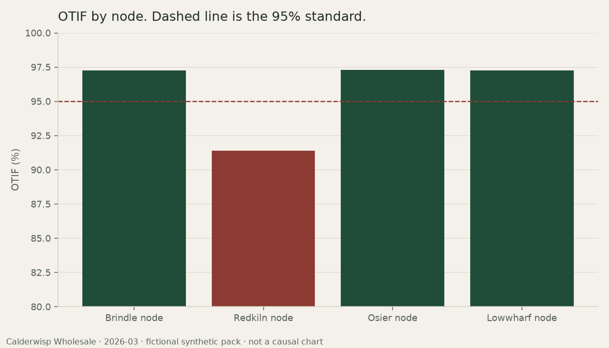

# Ops Narrative

Operations and finance teams lose days turning a KPI pack into the paragraph a close meeting will actually read. The numbers are already in the pack. The delay is the commentary: which gaps are material, which ones break a standard, and which sentences would invent a cause the pack does not contain.

Ops Narrative drafts that commentary from a structured pack and cites every figure back to the metric that produced it. A reviewer then scores the draft for faithfulness. A figure in the text has to match the pack. A cause that was not supplied does not get written.

The default engine is deterministic. It does not call a paid model, and it does not need an API key. An optional polish hook exists and is off unless you explicitly enable it. This build does not ship a provider.

The sample company is **Calderwisp Wholesale**, a fictional wholesaler. Nodes, categories, notes, and figures are synthetic and generated in this repository. They are not a real business, a real network, or a real close.

## What the assistant will and will not claim

It will claim:

- Levels and comparisons that are on the pack: actual, plan, prior period, and prior year
- Arithmetic the metric engine defines: profit, margin, days of supply, OTIF, forecast accuracy, fill rate, variances, and a variance share
- Whether a movement clears the published materiality bar, and whether a result breaks a published standard
- The wording of an operating note, quoted in full, as recorded context

It will not claim:

- A cause, a customer outcome, or a market fact the pack does not contain
- A price, volume, or mix bridge, or any other bridge that was not supplied
- That a note explains a neighboring metric. A service note is not a revenue bridge, and expedite cost is not an explanation of OTIF
- A new forecast, a target, or an action size
- A decision. The brief can ask a reviewer a question. The question adds no new figure

Plan is the performance baseline. The plan already includes seasonality, so a step-up from the prior month is context, not a second verdict. A node or category that only repeats the network movement is left off the variance table. Meeting a standard exactly is not a breach: 95.0% OTIF meets a 95.0% standard.

The full bars, the concentration rule, and the template coverage profiles are in [ARCHITECTURE.md](ARCHITECTURE.md).

## Approach

1. Generate a seeded history for a fictional four-node wholesaler and cut self-contained monthly packs. Leaves hold additive inputs only. Rates are computed later so a stored ratio cannot disagree with the units underneath it.
2. Build a fact sheet: rollups, variances, material movements, exceptions, and the occasional cell share.
3. Render a pinned template (`month_end.v1.0.0`, `variance.v1.0.0`, or `exception.v1.0.0`) by inserting canonical displays as citations.
4. Review the markdown independently: rebuild the fact sheet, match every citation, reject leftover numerals, check that "below" and "above" agree with the sign, and reject causal connectors.
5. A retired template, `month_end.v0.9.0`, still renders a scorecard. Reviewing it against the v1 profile fails on purpose. Template identity is part of the contract, not a label.

## Sample

March 2026 is the worked month. Network revenue is 1.0% under plan, inside the materiality bar. Gross margin is 59 bps above plan, and the beat is broad rather than local, with no cost bridge on the pack. Network OTIF still meets the 95% standard. Redkiln node does not. Personal care forecast accuracy is through the 80% floor, and the pack has no note, so the brief does not assign a cause.

The March month-end brief is [samples/outputs/2026-03-month-end.md](samples/outputs/2026-03-month-end.md). Each figure in that file is a citation. Read as prose, the headline is: net revenue closed at $43.7M, 1.0% below plan and 1.0% below the prior year, inside the materiality bar; gross margin was 27.2%, 59 bps above plan; network OTIF of 95.7% meets the 95.0% standard, and the service breach sits at Redkiln node.

The review record is [samples/outputs/2026-03-review.json](samples/outputs/2026-03-review.json): faithfulness 1.00, coverage 1.00, 116 citations, no ungrounded numeral.



Also generated for the same pack:

- [Variance commentary](samples/outputs/2026-03-variance.md)
- [Exception brief](samples/outputs/2026-03-exceptions.md)
- [Revenue versus plan](samples/figures/2026-03-revenue-vs-plan.png)
- [Forecast accuracy by category](samples/figures/2026-03-forecast-accuracy.png)

Regenerate everything from the seed:

```bash
ops-narrative samples
```

The same entry point is `python scripts/regenerate_samples.py`.

## How to run

Requires Python 3.11 or newer.

```bash
python -m venv .venv
source .venv/bin/activate
pip install -e ".[dev]"
pytest
ops-narrative narrate --pack data/synthetic/2026-03.json --kind month-end --review
```

Other commands:

```bash
ops-narrative templates
ops-narrative narrate --pack data/synthetic/2026-03.json --kind variance --out /tmp/variance.md
ops-narrative narrate --pack data/synthetic/2026-03.json --template month_end.v0.9.0
ops-narrative review --pack data/synthetic/2026-03.json --narrative samples/outputs/2026-03-month-end.md
ops-narrative charts --pack data/synthetic/2026-03.json --out samples/figures
streamlit run src/ops_narrative/app.py --server.port 8741
```

The workbench loads a pack, renders the selected template, and shows the gate. The sidebar control labeled "Inject an uncited figure" appends a sentence the reviewer should reject. That control is a demo of the gate, not part of the brief.

`pytest` is the test command. It covers the metric formulas (including rollups that are not averages of ratios), materiality and exception boundaries, generation determinism, citation faithfulness, direction language, the optional polish hook, and a CLI and Streamlit smoke test.

## Layout

```
src/ops_narrative/     metric engine, templates, reviewer, CLI, Streamlit app
data/synthetic/        generated monthly packs and a manifest
samples/outputs/       March briefs and the review record
samples/figures/       charts for the March pack
tests/                 pytest suite
scripts/regenerate_samples.py
```

## Development notes

Add a metric in three places that have to move together: the additive or derived definition in the metric engine, the label and the bar in `ops_narrative.policy`, and a test that fixes the formula with hand arithmetic. If the narrative should mention it, add it to the scorecard tuple. Do not format the number in the template with an f-string. Cite a fact, or the reviewer will treat the numeral as ungrounded.

Add a template by registering a new id in `narrative/templates.py`, a prompt with the same id, and a renderer branch. Leave the previous id callable. Set the coverage profile to what that id actually promises. A scorecard template must not be given an exception-coverage flag it does not satisfy.

The review bar for a change that touches prose:

- Every visible number is a citation whose text equals the canonical display
- Variance words match the sign of the signed fact
- The brief does not use causal connectors
- The template's coverage profile still passes
- `ops-narrative samples` has been re-run if the committed March files changed

Thresholds live in `policy.py` only. A sentence that restates a bar in its own words, with its own rounding, will drift.

The external hook reads `OPS_NARRATIVE_LLM`. Unset or `0` keeps the deterministic engine. `1` requires an in-process transport and still discards a polish that fails the gate. Do not add a key, a `.env` secret, or a default call to a hosted model. `.env.example` documents the flag and nothing else.

Do not add a real company, a real person, a customer file, or an internal URL. Pack text is rejected if it contains an email, a URL, or a phone pattern.

See also [CONTRIBUTING.md](CONTRIBUTING.md) and [CHANGELOG.md](CHANGELOG.md).

## Author

SBroTheLegend. The scoping in the claims boundary — what is a result, what is a standard, and what is still a question for a person — comes from a B.Sc Economics and an MBA (Finance and Analytics).

## License

[MIT](LICENSE)
